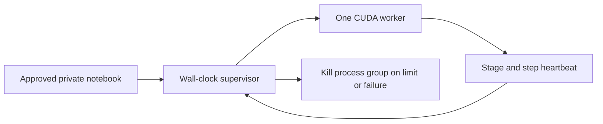

# Bounded training run design

No upload or Kaggle execution is authorized by this code. Before any run, check live account quota, owner-approved content/privacy and execution budget; use a private dataset/notebook with no collaborators. No paid quota purchase. CUDA is required; no silent CPU fallback.

A notebook launches one child process through an independent supervisor. Setup, training and evaluation have maximum budgets of 10, 30 and 5 minutes respectively; total wall clock is 45 minutes. The supervisor starts before imports/downloads, monitors child events without blocking on reads, stops after 120 seconds without progress, and kills/reaps the entire child process group. Budgets cannot be increased by worker messages. No retry or automatic resume. Worker caps at 5 epochs and 100 total optimizer steps, checks finite loss and aborts OOM/failures. Progress is emitted per step and stage; local checkpoint after each completed epoch. Event logs expose only reason codes/counts, never private input, child output or exception text.

Text equivalent: supervisor starts worker, reads bounded progress, then kills worker on any deadline or protocol failure. Normal completion also cleans descendants. Tests simulate short subprocesses inside the existing pinned CI container, without GPU or private data. Actual CUDA training remains unexecuted and needs its own approved smoke test.

Important limit: stopping a process does not guarantee Kaggle releases an allocated GPU session or stops quota accounting. An operator must monitor run status/output, use Stop/Cancel when a budget/no-progress stop occurs, then verify run terminal and interactive session off. The notebook return/exception is not proof the allocation ended. Kaggle documents a much larger platform session limit; that is not our budget. If disconnected, the child still self-bounds locally, but external session cleanup remains a monitored obligation. No claim of zero quota use or guaranteed remote cancellation is made.

Source: https://www.kaggle.com/docs/notebooks

CLI: python scripts/train_bounded.py --root APPROVED_PRIVATE_PATH. --root is the reviewed dataset directory. Notebook calls the same API. API supervise(command, total_seconds, stage_seconds, idle_seconds) accepts only positive budgets no greater than production caps; shorter values support synthetic tests. Outcome is a reason code; non-ok means no automatic rerun. Nothing here uploads data or starts a Kaggle session.

Progress heartbeats are allowed in every stage and must increase a stage-local counter. They reset only idle time, never stage/total deadlines. Cleanup timeout returns a safe failure code instead of masking it with an exception. Worker gates use explicit exceptions (also under optimized Python), and launch uses isolated mode. CUDA availability is checked before private manifest load/hash.
